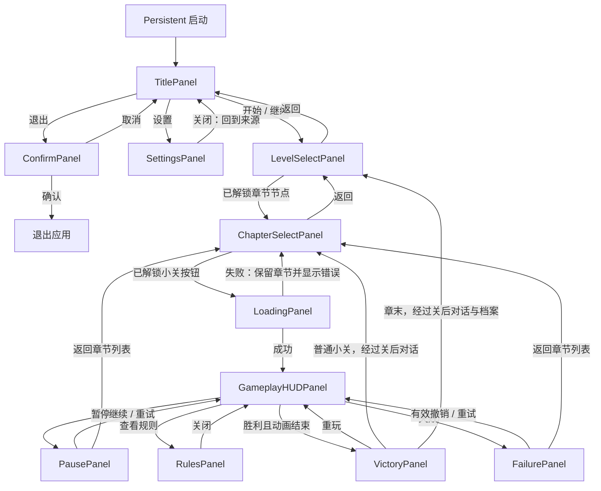

# 格命 UI 开发与交接文档

版本：0.6 ｜ 更新：2026-10-21 ｜ 状态：首版 UI Prefab 与五章关卡接入已实施；当前实施/验收见第 15 节及 UIEditingQuickStart.md

## 1. 目的与范围

把正式游戏 UI 从运行时代码搭建改成可在 Unity Project 中直接编辑的 Prefab，并保留已接通的玩法与进度功能。本文件用于逐项讨论界面、记录决定、安排开发和后续交接；不是已完成改造的报告。

本轮先规划，不修改代码、Scene、Prefab 或美术。优先范围为标题、选关、正式关内界面及共用弹窗。关卡编辑器与编辑器内试玩继续作为制作工具，暂不一起重做；其未保存确认、加载、保存与退出流程必须保留。

标记约定：**现有**为当前代码行为；**建议**为本稿方案；**待定**须讨论后记录决定。后续讨论只更新相关章节，并补充第 10 节记录。

## 2. 当前实现核对

| 模块 | 当前行为与入口 | 改造注意点 |
| --- | --- | --- |
| 标题 | `CampaignTitleScreen.Build` 生成背景、Logo、开始/继续、设置、退出；`CampaignRuntime.SceneLoaded` 在有 Art 配置时停用场景原 Canvas，再生成标题 | 不能只摆一个新 Prefab，仍让旧代码停用它；必须同时移除运行时替代路径 |
| 选关 | `LevelSelectionScreen.Start` 生成人体图、节点、详情；点击已解锁节点后显示局部图与进入按钮 | 目前节点按关卡逐个生成；虽有 bodyPart 字段，还没有完整“一个部位多关”的分组流程 |
| 关内 | `LevelPlayScreen` 及其 Presentation partial 创建 HUD、暂停/失败遮罩、规则、胜利卡片 | 动态棋盘与静态 UI 分开迁移，不修改玩法规则或 Shader |
| 通用弹窗 | `CampaignRuntime` 创建音量设置、退出确认、错误提示 | 改为共用 Prefab，由流程层传入数据与回调 |
| UI 基础 | 已有 `UIManager`、`UIPanel`，支持 Background / Normal / Popup / Top 层 | 当前正式流程未统一使用；缺失 Prefab 的空引用、场景切换缓存、输入拦截和弹窗返回栈仍须补齐 |
| 进度与配置 | CampaignRuntime / CampaignProgress、Catalog、Art、Presentation 负责运行状态与配置 | Prefab 不保存关卡进度、解锁真值或玩法会话 |

当前“开始/继续游戏”都进入选关，继续不恢复局内布局；没有清档新游戏流程。**当前正式胜利会等待棋盘动画后显示胜利卡片，由玩家返回人体图或重玩**。旧 `CampaignQuickStart.md` 的自动返回描述与当前代码不一致，实施时需同步修订，不能直接照旧说明开发。

## 3. 建议的 Panel 清单

Panel 指一块有独立打开/关闭职责的界面；标题中的按钮组、章节中的小关列表等只是子区域，不必全部升为独立 Panel。

### 3.1 首批主界面

| Panel / 归属 | 包含的子区域 | 功能与连接 | 数据与状态 |
| --- | --- | --- | --- |
| `TitlePanel` / TitleScene | 背景、Logo、菜单组、可选版本文字 | 开始/继续 → LevelSelect；设置 → SettingsPanel；退出 → ConfirmPanel | 根据正式完成进度决定按钮文字；无目录时展示错误，不进入空选关 |
| `LevelSelectPanel` / LevelSelect | 背景、完整人体图区、五个章节节点、完成统计、返回按钮 | 已解锁章节节点 → ChapterSelectPanel；返回 → TitleScene | 章节锁定、可进入、已完成、推荐、全部完成 |
| `ChapterSelectPanel` / LevelSelect | 章节标题、局部部位图、右侧纵向小关按钮列表、返回按钮；说明区域可选 | 已解锁小关 → Loading → Gameplay；返回 → 人体总览 | 章节 ID、各小关锁定/可玩/已完成、加载中、读取失败 |
| `DialoguePanel` / 跨场景流程覆盖 | 通用背景、角色立绘、姓名、对话框、继续提示 | 用于剧情与教程，在配置的关卡开始前或通关后播放；结束后继续原流程 | 对话组、当前句、显示进度；详见第 11 节 |
| `ChapterArchivePanel` / 章节叙事 | 档案标题、正文、配图、图注、返回/继续 | 章节完成后展示；支持已解锁档案回看 | 解锁、未读/已读、首次展示/回看；详见第 12 节 |
| `GameplayHUDPanel` / Gameplay | 棋盘容器、关名、目标、演化/分身计数、进度标记、操作区、模式提示 | 演化、撤销、分身、回收、取消；暂停 → PausePanel；规则 → RulesPanel | Playing、放置分身、回收分身；无历史/无额度等禁用态由控制器提供 |

选关采用两级界面，见第 3.4 节。建议两级 Panel 共用 LevelSelect Scene，切换时只显示其中一个，不必额外创建 Scene。小关暂用普通按钮，自上而下排列；建议点击已解锁按钮直接进入游戏，不再增加第三层选关或重复进入确认。

### 3.4 章节配置、参考图与解锁（2026-10-21）

用户明确五章及两级选关结构。部位按用户给出的顺序对应章节如下；左右具体落点应在后续 Prefab 视觉确认时标定，不能自行混用画面左右与人体解剖左右。

| 顺序 / 建议稳定章节 ID | 章节 | 内容 | 小关数 | 人体按钮位置 |
| --- | --- | --- | --- | --- |
| 1 / chapter_01 | 第一章 | 新手教程 | 2 | 左大腿 |
| 2 / chapter_02 | 第二章 | 基础死亡规则、迭代数限制 | 4 | 右盆骨 |
| 3 / chapter_03 | 第三章 | 分裂细胞 | 4 | 腰部脊椎 |
| 4 / chapter_04 | 第四章 | 区域繁殖、额外通关目标 | 4 | 心脏 |
| 5 / chapter_05 | 最终章 | 综合考验 | 4，暂定，按配置扩展 | 头部 |

当前暂按 18 关规划，最终章先按 4 关制作，数量由配置决定。章节 ID 为实现建议，尚未写入配置；真实 JSON 关卡 ID 与章节的映射待策划指定，不能按现有文件名猜测。用户提出的“分裂细胞”“区域繁殖”作为章节内容描述记录，是否与现有“分身”“局部繁殖”统一命名待定，不据此扩展新玩法规则。

**已明确的解锁规则：**

- 初始仅第一章及其第一小关可玩。
- 同章小关严格按列表顺序解锁：完成上一小关后解锁下一小关。
- 当前章全部小关完成，才解锁下一章；解锁下一章时开放其第一小关。
- 已完成关卡可继续重玩；不因重玩失败撤销完成记录或重新锁关（沿用现有进度语义）。
- 最终章全部完成后显示全通状态，不请求不存在的下一章。

章节解锁应依据上一章所有成员关卡的完成情况；小关解锁同时检查章节可进入及本章前置完成状态。不能只依赖节点按钮禁用，实际加载入口也应校验。进度继续按稳定关卡 ID 保存，章节完成状态由成员完成记录推导。章节配置需显式包含稳定 ID、顺序、名称、部位坐标、局部图及有序关卡 ID 列表；配置检查应拒绝空章节、重复归属、无效关卡引用。调整关序/归属可能改变解锁结果，需要明确迁移，不按列表序号重映射存档。

**参考图与布局：**

- 图一：`/Users/aoi/Downloads/选关界面下层无关卡版.png`，用作人体总览的视觉参考，在五个指定部位叠加章节按钮。原图为竖幅素材，横屏中的人体展示区保持比例，不横向拉伸铺满。
- 图二：`/Users/aoi/Downloads/20261021-142219.jpeg`，用作二级章节界面的构图参考：左侧局部放大/扫描图，右侧小关列表，左上返回。图中的占位文字、人物剪影及装饰不自动转为功能需求；人物区域是否保留待定。
- 小关列表用普通按钮模板 + VerticalLayoutGroup，顺序由章节数据提供。2–5 个按钮优先直接展示；小窗口或后续扩容时可滚动。美术调整列表容器、间距和模板尺寸，运行时不逐个写死位置。
- 建议章节按钮同时显示章序/短名与完成数，如“第二章 · 2/4”；锁定态显示锁图标与条件，完成态加勾，当前推荐章节高亮，避免只依靠颜色。
- 建议小关使用“2-1 关名”等展示编号；展示编号不充当存档 ID。锁定小关保留可见，禁止进入，并显示解锁条件。
- 参考图当前在本机 Downloads；正式接入时需放入项目资源并记录实际路径，不让构建依赖 Downloads。本次未复制或修改图片。

**返回与通关后的导航（已确认，待实现）：**

- 章节界面的返回/Esc → 人体总览；人体总览返回 → 标题。
- 关内暂停/失败的“返回选关” → 当前章节列表，保留来源章节。
- 普通小关胜利后，返回当前章节列表并高亮下一小关；章节最后一关胜利后，返回人体总览并高亮新解锁章节；最终章完成返回人体总览显示全通。
- 上述流程须统一 VictoryPanel 的按钮文字与行为，并串接配置的关后对话和章末档案（第 11.5 节）；当前代码仍是返回人体图，不能在未实现时宣称已有章节返回功能。

### 3.2 首批弹窗与覆盖层

| Panel / 层 | 内容与功能 | 关闭与返回 |
| --- | --- | --- |
| `SettingsPanel` / Popup | 音乐、音效滑杆，实时试听并沿用现有存储键；关闭时保存 | 回到打开它的界面；目标入口为标题与暂停菜单，关闭暂停内设置后仍保持暂停 |
| `PausePanel` / Popup | 继续、重新开始、设置、返回章节选关（已确认） | 继续/Esc 恢复；重试重建初始状态；返回丢弃本局状态 |
| `RulesPanel` / Popup | 本关规则开关、目标、操作说明，可滚动 | 关闭/Esc 返回关内；不执行任何棋盘命令 |
| `VictoryPanel` / Popup | 完成提示、关名、演化轮数、进度反馈；返回人体图、重玩本关 | 手动继续后串接关后对话；普通小关回章节列表，章末经档案回人体总览；保留重玩 |
| `FailurePanel` / Popup | 超过演化上限提示、撤销一轮、重新开始、返回选关 | 无历史时撤销禁用；不能用普通关闭按钮绕过失败状态 |
| `ConfirmPanel` / Popup | 共用标题、说明、取消/确认；用于退出游戏与离开本局确认 | 取消/Esc 无副作用；确认只执行一次对应动作 |
| `MessagePanel` / Popup | 目录、场景或其他阻断错误及关闭按钮 | 返回可恢复的来源界面，不清空进度或关卡选择 |
| `LoadingPanel` / Top | 读取/切换提示、输入遮罩 | 成功关闭并进入目标；失败关闭并恢复来源交互；暂无可信进度时不显示百分比 |

非阻断反馈（不能移动、名额不足、保存进度异常）优先写入现有提示区域；不为每次操作弹 MessagePanel。全部完成先复用胜利提示和选关状态，不另建结局界面。

### 3.3 可复用组件与后续候选

复用组件：`ChapterNodeItem`、`LevelEntryItem`、`ChapterArtworkView`、`IconActionButton`、`VolumeSliderItem`、`ObjectiveItem`。动态内容通过模板实例化，模板本身在 Project 可编辑。

剧情/教程对话与章节档案已加入需求范围（第 11、12 节）。候选且不进入首批承诺：棋盘内交互引导覆盖层、制作人员、独立结局、清档新游戏、键位修改、语言选择、画质与分辨率设置。第一章两关教程使用对话系统讲解；是否还需要棋盘高亮、操作检测等交互引导另定。

## 4. 界面连接与交互规则



以上为选关与基础玩法连接；加入对话和档案后的流程插入顺序以第 11、12 节为准，不从章末胜利直接跳过配置的通关后对话/档案。退出、错误等共用弹窗可由其他界面复用；关闭时回到实际来源。

- 每个场景同时只有一个主 Panel；暂停、规则、胜利、失败互斥。暂停 → 设置时，关闭设置必须回暂停，不能直接恢复玩法。
- Popup 遮罩阻止指针穿透，并由统一输入状态阻止方向键、Space、B、R、Z 直达棋盘；只挡射线不算完成。
- Esc 优先关闭最上层可取消弹窗，再取消分身/回收选择，最后切换暂停；Loading、胜利、失败不通过 Esc 意外恢复游戏。标题与选关上的 Esc 行为待定。
- 暂停与规则冻结棋盘输入及表现动画。暂停不依赖 UI 改玩法数据；关闭规则后恢复原有允许交互状态。
- 进入关卡及场景切换期间只接受一次请求，禁用重复点击；失败保留已选关卡并恢复进入按钮。没有超时/取消机制前，不提供会误导的取消加载按钮。
- 胜利进度由 CampaignRuntime 记录一次，UI 只显示结果；重玩与关闭胜利卡片不能重复写进度。动画结束后才展示结算。
- 返回选关不保留局内布局和撤销历史。离开关卡须显示确认提示“退出本局状态不会保存”（用户指定原文）；该提示只指局内布局/历史，不抹除通关记录。重新开始沿用直接执行方案。
- 当前失败条件为再次尝试超过演化上限；达到上限仍可移动等操作。UI 不得自行按轮数判失败。

## 5. Prefab 与代码职责建议

### 5.1 文件位置与组织

若沿用现有 Resources 加载约定，首批 Panel 放 `Assets/Resources/UI/<Panel类名>.prefab`，根组件类名与资源名一致。组件模板放 `Assets/Game/Prefabs/UI/Components/`，通过 Inspector 引用，不必全部放进 Resources。

这些目录与类型是拟新增项，目前未创建。各 Panel 建议为 RectTransform 根，在共用 Canvas 下挂载，避免每个 Prefab 再创建一套 Canvas/EventSystem。

```text
UIRoot（统一 Canvas / CanvasScaler / GraphicRaycaster）
├── BackgroundRoot
├── NormalRoot       ← 当前场景主 Panel
├── PopupRoot        ← 弹窗与拦截遮罩
└── TopRoot          ← Loading / 过场遮罩
```

目标参考分辨率已确认为 1920 × 1080（16:9），采用 Scale With Screen Size，匹配值先保持 0.5。当前代码仍为 1440 × 900，实施时需迁移并检查图片、字号与棋盘范围，不能仅改数值就当作布局完成。场景切换后销毁场景主 Panel、清理其弹窗及事件；若 UIManager 常驻，必须清除失效缓存。Loading 的跨场景显示由唯一 UI 宿主管理，避免场景卸载时遮罩先消失。

### 5.2 职责边界

| 层 | 负责 | 不应写入的内容 |
| --- | --- | --- |
| Prefab / View | 静态层级、位置、锚点、字号、图片、按钮视觉状态；序列化组件引用 | 解锁判断、JSON 读取、通关记录、玩法真值 |
| UI 控制器 | 绑定点击、渲染状态、打开关闭、订阅与取消订阅 | 重写布局坐标、每次打开重复生成静态控件 |
| CampaignRuntime / CampaignProgress | 场景流程、关卡加载、解锁与进度 | 标题按钮位置、弹窗尺寸、图片摆放 |
| LevelPlayController / Session | 操作合法性、撤销、重试、胜败 | Prefab 层级和视觉排列 |
| Catalog / 美术配置 | 关卡 ID、标题、描述、位置与图片配置 | 临时选中态和本局计数 |

按钮监听统一在代码初始化时绑定，关闭/销毁时按生命周期清理；避免 Inspector 和代码重复接同一个动作。章节节点使用稳定章节 ID，小关按钮使用稳定关卡 ID，不能用文字或列表索引作为进度键。输入命令仍走现有控制器，不把“撤销”做成恢复 View 的假操作。

### 5.3 美术可编辑要求

- 背景、Logo、装饰、按钮与文字必须有明确独立对象名和序列化引用，双击 Prefab 即可选择编辑。
- 普通 UI 图片优先用 Sprite + Image，使美术可以通过 **Image → Source Image** 替换；当前 Texture2D / RawImage 与运行时 Sprite.Create 引用需要迁移或明确保留原因。人体裁切预览如继续用 RawImage，须写明改用 Texture 字段，不能承诺所有图都通过 Source Image 修改。
- 运行时只更新数据、状态和必要动态内容，不能在 Start/OnOpen 把美术已调整的位置、尺寸、颜色重新覆盖。
- 人体上的五个节点改为读取章节坐标，锚定到实际人体图片矩形；当前逐关的 Catalog.bodyPosition 不能继续代表章节。节点位置通过章节配置调整，并提供 Inspector 或编辑期预览；手动移动运行时节点不会成为永久配置。
- 图片保持比例，按钮有清晰点击范围与禁用态；装饰不拦截点击。长描述与规则可滚动，不能只依赖省略号隐藏必要信息。
- 棋盘是独立程序绘制内容，Prefab 提供 BoardHost 容器；换 UI 图片不等于能直接替换细胞 Shader 或地形规则。

## 6. 实施顺序与交付物

| 阶段 | 工作 | 完成判据 |
| --- | --- | --- |
| A：定方案 | 确认第 8 节首批问题，确定 Panel 清单及跳转 | 讨论结果入文档；候选功能不混入实施 |
| B：标题与共用弹窗 | 接入 UI 宿主；制作 Title、Settings、Confirm、Message；替换标题动态生成和停用旧 Canvas 的逻辑 | 标题 Prefab 可独立编辑，开始/继续、音量、退出均接通；旧 UI 不重复出现 |
| C：选关 | 制作 LevelSelect、ChapterSelect、章节节点/小关模板、Loading；接入章节配置和两层解锁校验 | 状态完整；失败可重试；坐标随人体图缩放；完成进度正确 |
| D：关内 | 制作 HUD、Pause、Rules、Victory、Failure；对接现有玩法 | 保持棋盘表现、规则、快捷键和编辑器试玩隔离；结算流程一致 |
| D2：叙事功能 | 制作 Dialogue、ChapterArchive；接入配置导出、立绘目录、触发与阅读状态 | 对话只完成一次续流程；章末叙事顺序稳定；档案回看不重复解锁或写通关 |
| E：验收与交接 | 多画幅、Prefab 编辑、流程检查；更新旧说明 | 手动记录通过项和未验项，列出所有 Prefab、脚本与 Inspector 接线位置 |

每阶段记录实际新增路径、配置方法和验证结果；不将“代码编译通过”记作“视觉与按钮验收通过”。生成工具只能负责初次创建或显式迁移，不得在运行或重复配置时覆盖美术手工改动。

## 7. 验收清单

### Prefab 编辑与布局

- [ ] 非 Play 模式双击标题/选关 Prefab，可调 RectTransform、文字与图片；保存后运行确实生效，停止后仍保留。
- [ ] 启动不会重新创建旧标题/选关 Canvas；无重叠按钮或重复事件。
- [ ] 基线 1920×1080，另测 1280×720 与窗口缩放；文字、按钮、人体节点、棋盘不被裁切或相互遮挡。其他目标画幅确认后补充。
- [ ] 中文字体完整；长关名、长描述、全部规则可读取；遮罩、禁用态和可点范围一致。

### 流程与数据

- [ ] 无进度/部分完成/全部完成的标题、选关状态正确；开始/继续不清档。
- [ ] 总览恰有五个章节节点；对应部位、章节内容、小关数正确，最终章数量确定后补齐。
- [ ] 初始只有第一章第一关可玩；同章逐关解锁；整章全部完成才开放下一章；直接加载入口也不能绕过锁定。
- [ ] 小关纵向顺序与配置一致；已完成关可重玩；重玩失败不锁回；最终章全部完成无越界请求。
- [ ] 二级返回保留正确层级；加载失败仍在原章节；关内返回与章末返回按最终确认方案验收。
- [ ] 关卡加载失败保留选择并恢复重试；连续点击不重复切场景；目录/场景缺失有可关闭提示。
- [ ] 选关 → 游戏 → 暂停/规则 → 游戏 → 失败/胜利 → 选关 → 标题可重复往返，无失效引用或残留遮罩。
- [ ] 暂停/规则阻止键盘及棋盘输入；Esc 不同时关闭弹窗又执行底层操作。
- [ ] 分身、回收、撤销、演化禁用条件来自玩法；失败撤销恢复真实会话；重试恢复初始状态。
- [ ] 胜利动画结束后显示卡片，完成与解锁仅记录一次；重玩和末关正常。
- [ ] 音量立即生效，关闭后与重新启动后保持；设置入口扩展时正确返回来源。
- [ ] 退出取消不退出，确认才退出；WebGL 上退出入口需适配，不能承诺关闭浏览器页面。
- [ ] 编辑器试玩不记录正式进度；已有编辑草稿、保存/加载和结束试玩不受影响。

## 8. 待讨论事项与建议默认值

已明确事项直接列结论；其余建议尚未确认，实施前继续讨论。

| 编号 | 问题 | 建议默认值 | 影响 |
| --- | --- | --- | --- |
| D01 已明确 | 人体节点代表什么？ | 五个部位对应五章，每章多关；同章逐关解锁，通完整章解锁下一章 | 见 3.4；数据与代码待实现 |
| D02 已明确 | 章节如何展示？ | 点击章节打开二级界面，参考图二；右侧普通小关按钮从上到下排列 | 新增 ChapterSelectPanel；共用 Scene 为建议 |
| D03 | 标题是否需要独立的“新游戏”和“继续”？ | 维持单一开始/继续入口，不清档、不恢复局内状态 | 如要清档，必须补存档与确认方案 |
| D04 已确认 | 胜利后如何推进？ | 胜利卡片 → 配置的关后对话 → 普通小关回章节列表；章末再展示档案后回人体总览；保留重玩 | 第 11.5 节，待实现 |
| D05 已确认 | 暂停要哪些入口？ | 继续、重新开始、设置、返回章节选关 | 关闭设置回到暂停 |
| D06 已确认 | 重试/离开是否再确认？ | 重试直接执行；返回确认文案为“退出本局状态不会保存” | 保留已完成关卡记录 |
| D07 部分明确 | 剧情与教程如何展示？ | 共用背景 + 对话框 + 角色立绘，关前/关后触发；打字机、跳过、重播待定 | 第 11 节；交互式棋盘引导另定 |
| D08 画幅已确认 | 目标画幅与操作平台？ | 1920×1080，16:9；PC/WebGL 为当前规划 | 最小窗口与其他平台另定 |
| D09 | 是否支持全套键盘/手柄菜单导航？ | 本轮确保鼠标 UI + 现有玩法键盘；完整焦点导航另定 | 默认选中、导航顺序、焦点恢复 |
| D10 部分确认 | 对话打字机、跳过和重玩时播放策略？ | 采用打字机约 30 字/秒，点击或 Space/Enter 先补全再推进；整段跳过独立入口 | 包括教程首次播放均可跳过；按 Story/Tutorial 分类的回看方案讨论中 |
| D11 已确认 | 档案能否回看、入口在哪里？ | 允许；对应章节二级选关中设置固定“章节档案”按钮，显示锁定/新/已读；回看返回来源章节 | 阅读不阻挡下一章解锁；待实现 |
| D12 | 完整对话触发配置与档案正文来源？ | 当前附件只有 Dialogue!A1 表头；待提供含内容与触发位置的已保存版本；档案数据另列配置 | 不猜测具体关卡触发点或编造正文 |

接下来补充完整对话配置、档案内容、各章实际 JSON 关卡归属；最终章暂按 4 关并读取配置。左右部位落点、人物区域及是否点击小关直接进游戏，在布局细化时确认。

## 9. 后续接手者入口

先读本文件第 8、10 节确认已决事项，再检查实际代码；本稿未确认部分不可当成已经批准的功能。

- 玩法与规则：`Docs/GameDesignDocument.md`。
- 正式流程旧说明：`Docs/CampaignQuickStart.md`（胜利返回描述需同步当前实现）。
- 历史验证：`Docs/ImplementationStatus.md`。
- 流程与运行时 UI：`Assets/Game/Runtime/Gameplay/Campaign/`。
- 玩法表现：`Assets/Game/Runtime/Gameplay/LevelPlay/LevelPlayScreen.cs`、`LevelPlayScreen.Presentation.cs`。
- UI 基础：`Assets/Game/Runtime/Core/UI/UIManager.cs`、`UIPanel.cs`。
- 数据与资源：`Assets/Game/Runtime/Data/Campaign/`、`Assets/Resources/Campaign/`、`Assets/Resources/LevelPlay/Presentation.asset`。

注意：工作区已有未提交的代码、美术、Scene 和关卡修改。本次仅新增本文档，不将这些现有改动归为 UI Prefab 改造成果。

## 10. 决策与变更记录

| 日期 | 版本 / 事项 | 结论 | 实现状态 |
| --- | --- | --- | --- |
| 2026-10-21 | v0.1，建立独立 UI 开发文档 | 用户提出先规划界面、Panel、连接及功能；依据当前代码记录现状并提出方案 | 文档已建立；Panel 方案待讨论，Prefab 改造未开始 |

| 2026-10-21 | v0.2，D01 / D02 | 用户明确五章、部位顺序、小关数、两级选关、纵向普通按钮及章节/小关顺序解锁；最终章 4–5 关待定 | 已更新规划；返回层级为建议，未改代码或 Prefab |

| 2026-10-21 | v0.3，D07 / D10–D12 | 用户新增关前/关后剧情与教程对话、章末叙事档案；补充播放、资源与回看入口建议 | 仅文档；附件配置缺少内容与位置，回看及交互细节待确认 |

| 2026-10-21 | v0.4，确认 D04 / D10 / D11 | 用户同意上一轮方案：打字机先补全再推进，独立跳过入口；章末胜利 → 关后对话 → 档案 → 人体总览；章节内档案按钮支持回看，阅读不阻挡下一章 | 规划已确认，未改代码/Prefab；教程首次跳过、重玩策略及完整内容配置仍待补充 |

| 2026-10-21 | v0.5，用户补充 8 项 | 暂停四入口通过；返回文案“退出本局状态不会保存”；教程允许跳过；最终章档案看配置；1920×1080；最终章先按 4 关 | 仅文档。进度含义与新表结构、对话分类/回看正在讨论，未修改工作簿或代码 |

后续记录格式：日期、D 编号、最终决定、受影响 Panel、对应实现/验收状态。已否决方案从正文建议中移除或改为历史说明，避免交接者遇到两个有效版本。


## 11. 对话系统（主流程与基本播放方式已确认）

### 11.1 已明确范围与配置核对

用户要求独立的对话功能，共用通用背景，以对话框 + 角色立绘呈现，用于剧情和教程，在关卡开始前或结束后弹出；出现位置由配置决定。首版按线性对话规划，分支选项、配音、自动播放和对话历史尚未提出，不默认加入。

只读核对来源 `/Users/aoi/Downloads/Database.xlsx`：当前文件唯一工作表为 `Dialogue`，只有 A1=`dialogueId`，未发现其他非空单元格、触发配置或批注。故现阶段无法逐条抄录“出现位置”；需用户提供包含内容及位置的已保存版本后复核。本次未修改或导出该工作簿。

项目已有 Excel 读取框架、导出菜单与对话开始/结束事件，但未发现实际 Dialogue 表读取实现或播放控制器，不能视为功能已接通。现有导出菜单读取 `Assets/GameData/database.xlsx`，输出 `Assets/Resources/GameData/database.json`，与 Downloads 附件不是同一文件。正式接入需明确项目内唯一源表、对应表模型与导出校验，运行游戏读取已导出数据，不依赖 Excel 软件或本机 Downloads。

### 11.2 Panel 与资源

建议 `DialoguePanel` 为全屏流程覆盖界面：BackgroundImage、PortraitLeft、PortraitRight、NameLabel、DialogueBox、BodyText、NextIndicator、可选 SkipButton。两个立绘槽支持说话者切换和单人对话；首版是否同时出现两人待定。旁白可隐藏姓名与立绘，不用虚构角色占位。

- 立绘图片建议放 `Assets/Arts/Character/Portraits/<characterId>/`，例如 `doctor/neutral.png`、`doctor/smile.png`。这是拟定组织方式，不代表现有文件；导入为透明背景 Sprite，保持比例，不拉伸。
- 通过角色目录 ScriptableObject（建议 `Assets/Resources/Dialogue/CharacterCatalog.asset`）把稳定 characterId + portraitId 映射到 Sprite、显示名、默认立绘。Excel 填 ID，不填绝对磁盘路径；改显示名不影响引用。
- 通用背景和对话框装饰通过 Prefab / 表现配置直接引用；背景不能烘焙进文字和立绘。立绘槽的位置、大小与对话框尺寸留给美术编辑。
- 缺表、重复对话行 ID、未知角色/立绘、非法触发时机、无效关卡引用应在导出/构建前报错。运行时缺表提供可恢复提示和可控续流程；缺图片可退默认立绘或隐藏，但不丢失正文、不形成无限等待。

### 11.3 建议配置合同（不是附件已有字段）

为避免多行重复维护触发条件，建议把“对话组触发”和“逐句内容”拆开。下面仅定语义；等完整源表核对后再决定实际 Sheet 名及列名，不直接改用户表。

| 数据 | 必要字段 | 说明 |
| --- | --- | --- |
| 对话组 | dialogueId、levelId、timing、order、replayPolicy | timing 首版为 BeforeLevel / AfterWin；同触发点多组按 order 排序；不要用 Excel 行号当播放 ID |
| 对话行 | lineId、dialogueId、lineOrder、speakerId、portraitId、text、side（可选） | lineId 全局稳定，dialogueId 可在多行重复；按 lineOrder 播放；旁白允许空 speakerId |
| 角色目录 | characterId、displayName、defaultPortraitId、各 portraitId 对应 Sprite | 文本与图片引用分离；立绘切换不写在文本特殊命令里 |

教程与剧情可增加 kind 字段用于播放策略，但首版使用同一 Panel。若已有 Excel 的 dialogueId 原意为“单句 ID”，需先显式映射 lineId 与组 ID，不能直接变更含义。配置注释不作为运行时触发条件，位置应能导出为结构化数据。

### 11.4 播放与输入

- 默认打字机约 30 字/秒，可配置速度并允许关闭效果。文字按 TMP 可见字符逐步显示，排版一次完成，不因逐字拼接不断跳行；富文本标签不计作字符。
- 点击对话框/继续按钮，或按 Space/Enter：尚在打字则立即显示本句；本句已完整则下一句。末句结束只触发一次完成回调。避免同一输入同时补全并翻过一整句。
- 整段跳过是独立按钮，建议二次确认；教程首次播放也允许跳过（已确认）。跳过仅跳该组文本，不跳关、不判通关。Esc 不直接关闭正在承担流程的对话。
- 播放期间拦截底层棋盘与菜单操作；启动对话和结束对话的按键不透传到 Gameplay，Space 翻页不能同时演化。
- 对话期间使用独立于 Time.timeScale 的 UI 时间；失焦停止推进，恢复后保留本句与当前显示进度。不新增自动播放，避免未读内容自行消失。
- 建议首次进入自动播放配置内容，重玩时不强制反复观看已读剧情；教程关前内容可通过重玩时的“重看教程”入口重播。首次跳过已允许；回看入口及 Story/Tutorial 分类方案见第 13 节，待确认。
- 对话组正常结束才保存已读标记；确认跳过后的已读/已跳过状态应明确保存。中途退出未完成组，下次从组开头重播，首版不做逐句续读。该策略不影响关卡通关存档。

### 11.5 与关卡、章末的连接（已确认）

关前：点击可玩小关 → 校验并加载关卡数据 → 播放已配置 BeforeLevel → 初始化并开放棋盘。对话播放前，玩法不能抢先接受输入；读取失败不应先消耗对话已读状态。

关后：目标达成 → 记录完成与解锁一次 → 等待棋盘动画 → 胜利卡片 → 玩家继续 → 播放已配置 AfterWin → 若本章首次全部完成且配置了档案，展示章节档案 → 普通小关返回当前章节列表并高亮下一小关；章末档案结束后返回人体总览并高亮新章节，最终章则显示全通状态。这里的关后指成功通关后，失败不触发；若需失败剧情，另增明确时机。

流程由控制器串行调度，不能让多个 Panel 各自收到胜利事件后争相打开。首次章末对话结束后才展示档案；配置为空时直接继续，不出现空白对话框。对话重播/跳过不重复结算、解锁或自动跳入下一关。

## 12. 章节档案（章末展示与回看已确认）

### 12.1 内容与布局

用户要求章节结束后展示叙事档案，视觉参考 `/Users/aoi/Downloads/20261021-143020.jpeg`：纸张通用背景、左侧报告标题与正文、右侧大配图与图注、编号/条码等装饰。参考图是构图依据，图中占位文字不转成正式故事内容，条码不默认带扫描功能。

建议 `ChapterArchivePanel` 作为全屏阅读界面，由同一个 Prefab 显示各章数据。可编辑对象：Background、ArchiveNumber、Title、BodyScroll、Illustration、Caption、ContinueOrBackButton；必要时使用预设分页，不把长正文缩成难读小字。支持 4:3/16:9 等目标画幅时以最终画幅要求验收，不默认图片上的字号可直接沿用。

章节是否有档案由配置决定，最终章同样处理：archiveId 为空则无档案，章末对话结束后直接返回人体总览/显示全通；有配置则展示。独立结局尚未提出，不默认制作。建议配置 archiveId、chapterId、title、body、illustrationId、caption、displayOrder；正文由独立表或配置资源提供，尚未获得实际内容来源。图片建议放 `Assets/Arts/Archive/`，用资源目录映射 illustrationId；数据不嵌入图片，便于改字与交接。

### 12.2 解锁、已读与首次展示

- 章节全部小关完成且配置了档案时立即解锁对应档案，与下一章解锁同一次流程更新。档案已读状态独立保存，阅读不是解锁下一章的额外条件（已确认）。
- 首次完成章节，按第 11.5 节顺序在关后对话结束后打开档案。建议通过“继续”完成首次展示；回看时按钮改“返回”。
- 持久化完成关卡、已读对话组、已读档案；章节/档案解锁优先由章节成员完成记录推导，避免重复真值不一致。数据版本变化不能静默覆盖损坏进度。
- 章已完成但档案未读时显示“新”标记。若首次章末流程中退出，重启后档案仍可访问且未读，建议在该章选关突出提示，不自动强迫重播所有章末内容。
- 重玩已完成的章末关不会自动重弹档案；玩家可主动回看。回看不再次记录胜利、解锁、播放章末对话或推进章节。

### 12.3 档案回看与入口（已确认）

**允许反复阅读已解锁档案。** 叙事线索可能需要对照，且玩家可能第一次阅读时跳过或中途退出；档案只有五章规模时，不必先做复杂的收藏系统。

回看入口放在 `ChapterSelectPanel`：章节标题/进度附近设置固定的“章节档案”按钮，与右侧小关按钮组分开，避免看起来像另一关。

- 未配置档案：不显示档案入口，不弹空档案。
- 章未通关且有档案配置：显示“章节档案 · 通关本章后解锁”，禁用，不提前展示标题/正文等剧情信息。
- 章已通关未读：显示“章节档案 · 新”。
- 已读：显示“查看章节档案”，仍可重复打开。
- 打开时保留来源 Panel、chapterId 与滚动状态；返回恢复该章选关，不跳回标题或重新初始化游戏。

人体总览可在已完成章节节点旁加小档案标识作为提示（建议只提示，不新增重叠点击区）。首版不必在标题再放“档案馆”；若以后有跨章线索、额外收藏或很多档案，再加总览“档案馆”入口复用同一阅读 Panel。

### 12.4 补充验收

- [ ] 对话配置可导入且触发到正确关卡/时机；未配置不弹空框，同点多组顺序确定。
- [ ] 打字机补全、推进、跳过各自只响应一次；富文本/中文不跳版，长句完整可读。
- [ ] 对话与档案期间鼠标/键盘不透传；结束不会意外触发演化或进入下一关。
- [ ] 立绘 ID 映射正确；旁白、缺图、说话者切换和文字换行正常；改 Prefab 排版不被运行时覆盖。
- [ ] 关前读取失败、关后完成、重玩、失焦、中途退出恢复遵循最终确认的策略。
- [ ] 普通小关不弹章末档案；章末按“胜利 → 关后对话 → 档案”串行显示，完成进度不重复写入。
- [ ] 档案锁定/新/已读正确，重启保留；所有已解锁档案可回看，返回原章节，回看不推进游戏。
- [ ] 最终章数量确定后，章末检测读取真实成员列表，不写死第 4 或第 5 关。


## 13. 数据表结构讨论方案（2026-10-21，未修改工作簿）

### 13.1 进度与继续游戏含义

当前 CampaignRuntime 已按 Campaign.Progress.v1 保存完成的关卡 ID（PlayerPrefs，本机持久化），启动时读取，完成时 Save。当前继续入口进入人体选关，不恢复离开时的棋盘、角色位置或撤销历史，也不是云存档。章节、对话与档案接入后建议扩展有版本的存档模型：完成关卡、已读/已跳过对话组、已读档案。迁移保留旧完成记录，不把 UI 按钮索引当作存档键。

“继续游戏”建议维持进入人体总览并高亮可继续章节；是否需要恢复到上次章节列表可另定。保存完成进度是现有功能，不需从零新增；当前仍为线性解锁，章节完整条件待改造。

### 13.2 对话分类与回看建议

在对话组增加 kind=Story / Tutorial，分类与触发时机分开。两者均支持关前/关后触发及首次跳过，不用角色或文本关键词猜是否教程。同一触发点可配多个组，按 order 串行播放。

建议首次自动播放，已读/已跳过组在重玩时不强制弹出；当前章节内提供“对话回顾”入口，按小关归属列出已解锁组并标记“剧情”或“教程”，玩家主动选择重播。这可同时解决“重看教程”与“重看普通对话”的区分，建议用统一入口替代只有教程的按钮，尚待用户确认。回顾不改变通关状态或再次执行触发后的流程。

教程回顾在首次遇到该教程组后开放；Story 关前组在首次开始展示时解锁，关后组在对应通关时解锁，防止提前剧透。已解锁、已读和已跳过应区分；跳过不永久丢失回看资格。失败不开放尚未触发的关后内容。

### 13.3 推荐由 Database 统一维护的工作表

下面是可讨论的目标结构，不代表当前附件已有数据。Workbook 文件命名、正式项目源路径在接入时统一。数据库描述关系与文本，JSON 继续存棋盘及玩法规则；图片由 Unity 资源目录提供引用映射。正式导入时由表生成运行配置，不能同时要求手动维护一份不同内容的 Catalog。

| Sheet | 每行代表 | 建议列 |
| --- | --- | --- |
| Chapters | 一章 | chapterId、order、title、bodyPart、nodeX、nodeY、chapterImageId、archiveId（可空） |
| Levels | 一个正式关卡入口 | levelId（对应 JSON 内 ID）、chapterId、order、title、description |
| DialogueGroups | 一段连续对话与触发点 | dialogueId、kind（Story/Tutorial）、levelId、timing（BeforeLevel/AfterWin）、order |
| Dialogue | 一句台词 | lineId、dialogueId、order、characterId（旁白可空）、portraitId（可空，使用默认）、side（Left/Right，可空）、text |
| Characters | 一个角色 | characterId、displayName、defaultPortraitId |
| Archives | 一份章节档案 | archiveId、title、body、illustrationId、caption |

章节与角色不用直接关联：章节通过 Levels 找所属关卡，再按 DialogueGroups 找对话组，每句通过 characterId 找角色。这允许一个角色跨章节出现，同一段里多个角色轮流说话，也避免把立绘绑死在某章。Archives 用 Chapters.archiveId 关联，一章可没有档案；首版一章至多一份。

Unity 维护一个可在 Inspector 编辑的图片目录：portraitId → Sprite、chapterImageId → Sprite、illustrationId → Sprite。角色/立绘 ID 都必须稳定；改文件位置后通过 Unity 资源引用保持连接，Excel 不写磁盘路径。nodeX/nodeY 为完整人体展示矩形上的 0–1 坐标，需要可视预览辅助美术调整。

示例（仅演示关联，不代表真实关卡或故事）：

- Chapters：chapter_01，order=1，archiveId=archive_01。
- Levels：levelId=<策划实际 JSON ID>，chapterId=chapter_01，order=1。
- DialogueGroups：tutorial_move，kind=Tutorial，levelId=<同上>，timing=BeforeLevel，order=1。
- Dialogue：lineId=tutorial_move_001，dialogueId=tutorial_move，order=1，characterId=guide，portraitId=guide_neutral，text=<实际教程文本>。
- Characters：guide，displayName=<角色名>，defaultPortraitId=guide_neutral。
- Archives：archive_01，title=<档案标题>，body=<正文>，illustrationId=archive_01_image。

当前没有确定的真实关卡 ID，不生成伪造 JSON 来填满 18 个入口。Prefab 可以用清晰标注的编辑期示例预览；正式构建必须校验 ID 对应关系和 JSON 是否存在。最终章暂按四项容量规划，实际小关按钮数与章末判断都取配置列表长度。

### 13.4 接下来如何配合

先确认上面的六表划分，以及“对话回顾统一列出剧情/教程”的方案；然后由开发方建立带字段说明、示例和校验的表模板，用户/策划填写正式内容。立绘和档案图导入 Unity 后配置图片 ID 映射，再实现导表与 UI。只要关系配置已明确，Prefab 骨架可先做，不必等所有台词与关卡设计完成。


## 14. 对话表实际转换与读取纠正（2026-10-21）

完整扫描原始工作簿后发现：缓存范围只声明 A1，但实际有 Dialogue A1:D99，含字段行、类型行、说明行及 ID 100–195 共 96 条文本。此前第 11.1 节和 D12 所述“只有表头”是读取范围错误，现予纠正，不能再据此要求用户补发空缺数据。

本次另存转换稿，原文件未覆盖。转换为 13 个组、42 条旁白；逐条核对原始 ID、台词、显示名、备注未丢失。Dialogue 列为 lineId、dialogueId、order、characterId、portraitId、side、text、speakerName、sourceNote。旁白 characterId 真正留空，不使用字面量 null；新增 speakerName 保留原显示名（包括？？），覆盖角色默认姓名。具名档案/终端可无立绘，不能将所有非空角色都强制配置人物图片。

DialogueGroups 保留 kind、timing、order，并以 chapterId、chapterLevelOrder、bindingNote 记录原备注中的位置；真实 levelId 未知，未猜填。最终章末尾标为实际最后一关，避免关数变化时触发到旧末关。教程暂按同关 BeforeLevel 在剧情后播放。原文 192–195 为四份档案，先保留在结尾，迁至 Archives 及章节归属待确认。填写说明包含字段规则与暂定角色 ID 映射；导表与游戏接入尚未实施。


## 15. 2026-10-21：关卡绑定及首版 Prefab 实施

已按实际 JSON ID 绑定五章：001/002；101–104；201–204；301–304；401–404，共 18 关。更新工作簿 Levels 及 13 个 DialogueGroups.levelId，末关剧情绑定 404。保留原粉红标记及其他内容。项目内源表为 Docs/GameData/Database.xlsx；玩家版加载 Assets/Resources/Campaign/Narrative.json。导出命令：python3 Docs/Tools/import-ui-database.py Docs/GameData/Database.xlsx。当前 JSON 显示名把教程单列，因此 101 的名称仍含“第一章”；不改写策划文件，章节关系按已确认五章列表。

UI 静态层级已迁移到 Assets/Resources/UI 下的 14 个 Prefab：TitlePanel、LevelSelectPanel、ChapterSelectPanel、GameplayHUDPanel、PausePanel、FailurePanel、VictoryPanel、RulesPanel、DialoguePanel、ChapterArchivePanel、SettingsPanel、ConfirmPanel、MessagePanel、LoadingPanel。Canvas 采用 1920×1080；CampaignPanelView / GameplayHUDView 的序列化字段负责连接控件。由 CampaignInterface 管理主界面、模态输入、对话/档案；LevelPlayScreen 接现有玩法。棋盘仍为程序/Shader 渲染，不作为静态图片迁移。首次创建菜单 Tools/UI/Create Editable UI；已有 Prefab 不覆盖。

对话以 speakerName 和 portraitId 独立控制姓名与立绘，空姓名隐藏名称，空立绘隐藏图片。原 Characters 表暂作资源目录，台词直接使用立绘 ID player/o/kui，对应 Resources/UI/Portraits。移除教程与剧情的回顾入口，播放或确认跳过后记录已读，重玩不自动重复。记录键 Campaign.Narrative.v1；保留 Campaign.Progress.v1 的完成 ID，增加整章成员解锁检查。

美术编辑：停止 Play → Project 中 Assets/Resources/UI → 双击对应 Prefab → 改 RectTransform/Image/文字样式 → 保存 → 返回 Persistent 场景运行。LevelSelectPanel 五个章节按钮的位置在 Prefab 内，运行时不重设坐标；小关布局由 ChapterSelectPanel/LevelList 的 VerticalLayoutGroup 与 LevelButtonTemplate 控制。不要删除序列化字段引用的对象或清空组件引用；增加装饰不影响接线。章节局部图暂为线稿占位，可在 ChapterSelectPanel 的 ChapterArtwork 上换 Sprite；之后若为章节配置 artwork，则使用该章 Sprite。

验证记录：Unity 已实际执行创建菜单，14 个资源存在；标题 → 人体总览 → 第一章两关列表 → 001 关前角色对话已人工点击验证，无编译错误。启动重复 EventSystem 已发现并修复。独立 Editor/Player 编译通过；306 项逻辑检查通过（含新增 8 项章节进度检查）。完整通关、档案返回、所有分辨率与平台构建仍待对应验收，不能用编译替代。

实际运行补充：001 剧情/教程跳过、进入 Gameplay、规则关闭、暂停内设置返回、离开确认原文及返回原章节列表已点击验证。全量资源校验通过 14 Prefab、13 对话组及立绘；202.json 因缺少目标未通过玩法校验，其余 17 份通过。此为策划数据待补，不修改原 JSON。
